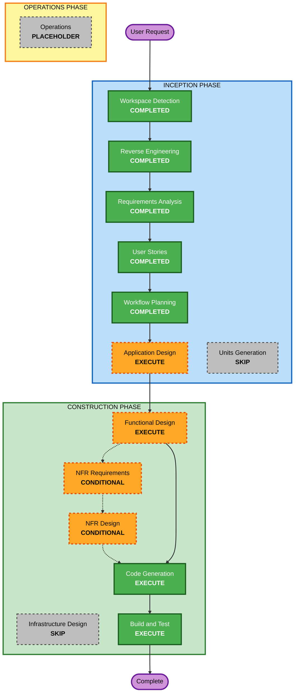

# Execution Plan

## Detailed Analysis Summary

### Transformation Scope
- **Transformation Type**: Application change across all components, no architectural
  transformation. The skills keep their roles and file hand-offs; inputs and outputs
  gain a per-candidate level.
- **Primary Changes**: Candidate selection, per-candidate paths, per-candidate
  preferences, and migration of loose CVs and legacy results.
- **Related Components**: `cv-reviewer`, `skill-extractor`, `job-finder`, `find-jobs`,
  `config/preferences.md` (becomes a template), `README.md`, `CLAUDE.md`.

### Change Impact Assessment
- **User-facing changes**: Yes. Command arguments gain leading candidate IDs, and files
  move to `profiles/<id>/` and `output/<id>/`.
- **Structural changes**: Yes, minor. Rules shared by every skill (selection, ID
  validation, migration) need a home so they aren't copied four times (NFR-4.1).
- **Data model changes**: Yes. `skills.json` gains `candidate_id` and moves to
  `output/<id>/skills.json`. This is breaking (`feat!`).
- **API changes**: Yes. The slash-command arguments change for all four commands.
- **NFR impact**: Yes. Privacy between candidates, ID validation, fail-closed migration.

### Component Relationships
- **Primary Components**: the four skills in `.claude/skills/`
- **Shared Components**: rules shared by every skill (new, location decided in
  Application Design); `config/preferences.template.md`
- **Dependent Components**: `job-finder` depends on the `skills.json` location written
  by `skill-extractor`; `find-jobs` depends on all three
- **Supporting Components**: `README.md`, `CLAUDE.md`

| Component | Change Type | Priority |
|---|---|---|
| Shared candidate rules (new) | Major | Critical: everything else uses it |
| skill-extractor | Major (output path, schema field) | Critical |
| job-finder | Major (input path, argument parsing) | Critical |
| cv-reviewer | Minor (paths, arguments) | Important |
| find-jobs | Major (loop over candidates) | Important |
| config template | Configuration-only | Important |
| README.md, CLAUDE.md | Docs | Important |

### Risk Assessment
- **Risk Level**: Medium. Migration moves personal data, and all four skills change.
- **Rollback Complexity**: Easy for the skills (git revert). Moderate for user data:
  migrated files must be moved back by hand, which is why migration never deletes or
  overwrites anything and reports every move.
- **Testing Complexity**: Moderate. Manual runs against the acceptance criteria in
  `stories.md`, using fictional test CVs.

### Key Design Questions for Application Design
1. **Where the shared rules live.** Options include a shared reference file that each
   skill reads, a helper skill, or a small script.
2. **Moving files.** The worker skills may only use Read, Glob and Write today. Write
   cannot move a binary PDF, so migration needs a narrowly scoped file-move capability
   (for example only `mkdir` and a no-overwrite `mv`). SECURITY-06 requires this to be
   least privilege.
3. **Script or no script.** Adding a script brings the property-based testing rules
   into force (PBT-02, 03, 07, 08, 09) and needs NFR Requirements for language and
   framework choice.

## Workflow Visualization



### Text Alternative
```
Phase 1: INCEPTION
- Workspace Detection    COMPLETED
- Reverse Engineering    COMPLETED
- Requirements Analysis  COMPLETED
- User Stories           COMPLETED
- Workflow Planning      COMPLETED
- Application Design     EXECUTE
- Units Generation       SKIP

Phase 2: CONSTRUCTION (one unit)
- Functional Design      EXECUTE
- NFR Requirements       CONDITIONAL (only if a script is added)
- NFR Design             CONDITIONAL (only if a script is added)
- Infrastructure Design  SKIP
- Code Generation        EXECUTE
- Build and Test         EXECUTE

Phase 3: OPERATIONS
- Operations             PLACEHOLDER
```

## Phases to Execute

### INCEPTION PHASE
- [x] Workspace Detection (COMPLETED)
- [x] Reverse Engineering (COMPLETED)
- [x] Requirements Analysis (COMPLETED)
- [x] User Stories (COMPLETED)
- [x] Execution Plan (COMPLETED, awaiting approval)
- [ ] Application Design - EXECUTE
  - **Rationale**: A new shared component (candidate selection, ID validation,
    migration) is needed, and so are decisions on where it lives, how skills use it,
    and how files get moved with least privilege.
- [ ] Units Generation - SKIP
  - **Rationale**: One unit of work. The four skills share one contract change and
    must ship together; splitting them would leave the product broken between units.

### CONSTRUCTION PHASE
- [ ] Functional Design - EXECUTE
  - **Rationale**: The business rules need precise definitions so every skill applies
    them the same way:
    - turning a name into an ID
    - collision and same-person matching
    - migration order
    - legacy result matching
    - argument parsing

    If a script is added, this stage also covers PBT-01 property identification.
- [ ] NFR Requirements - CONDITIONAL
  - **Rationale**: Execute only if Application Design adds a script, to choose the
    language and the property-based testing framework (PBT-09). Otherwise skip: the
    security and privacy NFRs are already in `requirements.md` and there's no tech
    stack to choose.
- [ ] NFR Design - CONDITIONAL
  - **Rationale**: Follows NFR Requirements.
- [ ] Infrastructure Design - SKIP
  - **Rationale**: Runs locally in Claude Code; nothing is deployed.
- [ ] Code Generation - EXECUTE (ALWAYS)
  - **Rationale**: Rewrite the four SKILL.md files, add the shared rules and template,
    and update the docs.
- [ ] Build and Test - EXECUTE (ALWAYS)
  - **Rationale**: Manual test script from the acceptance criteria, run against
    fictional test CVs.

### OPERATIONS PHASE
- [ ] Operations - PLACEHOLDER

## Package Change Sequence
1. Shared candidate rules and `config/preferences.template.md`. Everything else
   references them.
2. `skill-extractor`. It writes the moved `skills.json` contract.
3. `job-finder`. It reads the new contract location.
4. `cv-reviewer`. It is independent and only needs the shared rules.
5. `find-jobs`. It orchestrates the above.
6. `README.md` and `CLAUDE.md`.

All of these are one unit and ship together.

## Estimated Timeline
- **Total stages remaining**: 4 to 6 (Application Design, Functional Design, possibly
  NFR Requirements and NFR Design, Code Generation, Build and Test)
- **Estimated duration**: one to two working sessions

## Success Criteria
- **Primary Goal**: One JobFinder install serves many candidates without their data
  mixing, while a single user still runs it with no arguments.
- **Key Deliverables**: Updated four skills, shared candidate rules, preferences
  template, updated README and CLAUDE.md.
- **Quality Gates**:
  - Every acceptance criterion in `stories.md` passes in a manual run.
  - The current single-CV setup migrates with nothing lost.
  - Security compliance holds: ID validation, isolation, least privilege for file moves,
    no personal data in queries or in `aidlc-docs/`.
- **Integration Testing**: `/find-jobs` for two fictional candidates end to end.
