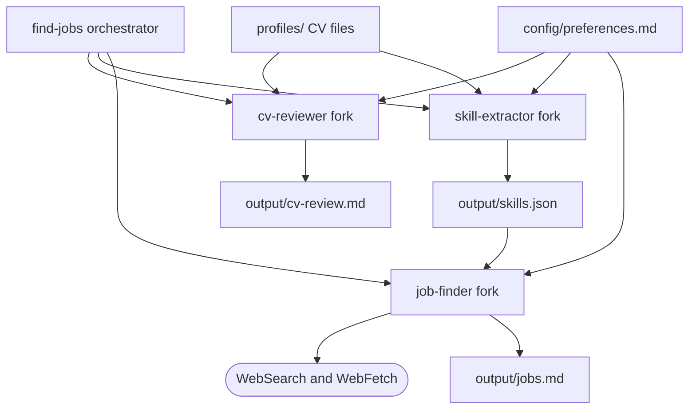
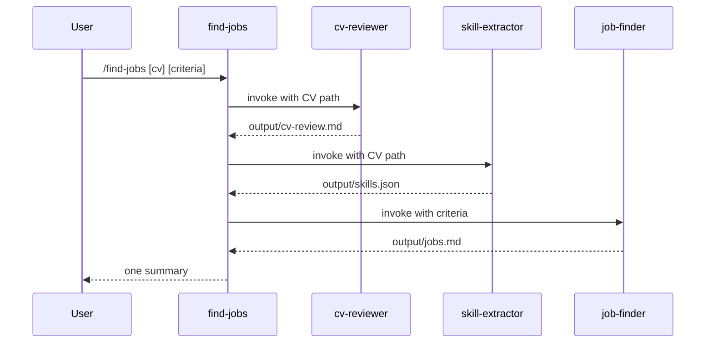

# System Architecture

## System Overview
JobFinder is a set of Claude Code skills. There is no compiled code: each skill is a
`SKILL.md` file of instructions with YAML frontmatter. Three worker skills run as forked
subagents (`context: fork`, `agent: general-purpose`). One orchestrator skill runs in
the main conversation and invokes the workers with the Skill tool. Skills hand off
through files in `output/`.

## Architecture Diagram

Text alternative: `find-jobs` calls `cv-reviewer`, `skill-extractor` and `job-finder`
in that order. `cv-reviewer` and `skill-extractor` read the CV from `profiles/`; all
three read `config/preferences.md`. `cv-reviewer` writes `output/cv-review.md`,
`skill-extractor` writes `output/skills.json`, and `job-finder` reads that file, uses
web search and fetch, and writes `output/jobs.md`.

## Component Descriptions
### cv-reviewer
- **Purpose**: CV review
- **Responsibilities**: Read the CV, score it, write `output/cv-review.md`
- **Dependencies**: a CV in `profiles/`, optional `config/preferences.md`
- **Type**: Application (forked skill; tools Read, Glob, Write)

### skill-extractor
- **Purpose**: Profile extraction
- **Responsibilities**: Read the CV, write `output/skills.json`
- **Dependencies**: a CV in `profiles/`, optional `config/preferences.md`
- **Type**: Application (forked skill; tools Read, Glob, Write)

### job-finder
- **Purpose**: Job search and ranking
- **Responsibilities**: Read `output/skills.json`, search, verify, write `output/jobs.md`
- **Dependencies**: `output/skills.json`, optional `config/preferences.md`, web access
- **Type**: Application (forked skill; tools Read, Glob, Write, WebSearch, WebFetch)

### find-jobs
- **Purpose**: Pipeline orchestration
- **Responsibilities**: Check inputs, invoke the three skills, validate the JSON, summarise
- **Dependencies**: the three worker skills
- **Type**: Application (inline skill, no `context: fork`)

## Data Flow

## Integration Points
- **External APIs**: Claude Code WebSearch and WebFetch (job-finder only)
- **Databases**: none; the file system is the only store
- **Third-party Services**: job boards and company career pages, read-only

## Infrastructure Components
- **CDK Stacks**: none
- **Deployment Model**: runs locally inside Claude Code in the repo folder
- **Networking**: none beyond Claude Code web tools

## Single-CV Assumptions (relevant to the current request)
1. Input selection picks one CV: the argument, else the newest file in `profiles/`.
2. Output paths are fixed (`output/cv-review.md`, `output/skills.json`, `output/jobs.md`),
   so a run for CV B overwrites CV A's results.
3. `job-finder` has no argument for which profile to use; it always reads `output/skills.json`.
4. `config/preferences.md` is one global file, not per CV or per person.
5. `find-jobs` takes one CV path and runs a single linear pipeline.
