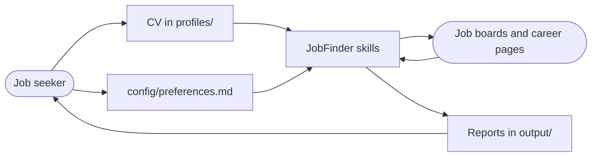

# Business Overview

## Business Context Diagram

Text alternative: the job seeker puts a CV in `profiles/` and optionally fills in
`config/preferences.md`. The JobFinder skills read both, search job boards and career
pages on the web, and write reports to `output/` for the job seeker to read.

## Business Description
- **Business Description**: JobFinder helps one job seeker go from a CV to a ranked
  shortlist of real, currently open job postings. It also reviews the CV the way a
  recruiter and hiring manager would.
- **Business Transactions**:
  - **Review CV**: score the CV and list prioritised fixes with before/after rewrites
    (`/cv-reviewer`).
  - **Extract skill profile**: turn the CV into structured JSON with skills, levels,
    years, evidence, target roles and search keywords (`/skill-extractor`).
  - **Find jobs**: search the web with the profile, verify each posting by opening it,
    score fit out of 100 and write a shortlist (`/job-finder`).
  - **Full pipeline**: run the three above in order and summarise (`/find-jobs`).
- **Business Dictionary**:
  - **CV / resume**: the candidate's document (PDF, DOCX or Markdown) in `profiles/`.
  - **Skill profile**: `output/skills.json`, the contract between the extractor and
    the job finder.
  - **Preferences**: search constraints in `config/preferences.md` that override
    anything inferred from the CV.
  - **Fit score**: 0 to 100 score of a posting against the profile and preferences.
  - **Verified posting**: a posting the job finder opened and confirmed is real and open.

## Component Level Business Descriptions
### cv-reviewer
- **Purpose**: Tell the candidate whether the CV would get an interview, and how to fix it.
- **Responsibilities**: Recruiter and hiring-manager reads, scoring, quoted fixes, questions for missing metrics.

### skill-extractor
- **Purpose**: Produce a searchable, evidence-backed profile of the candidate.
- **Responsibilities**: Normalise skills, estimate level and recency, propose target roles and search keywords.

### job-finder
- **Purpose**: Find real jobs that fit the profile.
- **Responsibilities**: Search, verify, deduplicate, score and report gaps.

### find-jobs
- **Purpose**: One command for the whole journey.
- **Responsibilities**: Orchestrate the three skills and give one summary.

## Key Observation for the Current Request
Every transaction assumes **one candidate and one CV**. Input selection is "the CV named
in the arguments, otherwise the most recently modified CV in `profiles/`", and every
output is a single fixed file path. A second CV overwrites the first CV's results.
