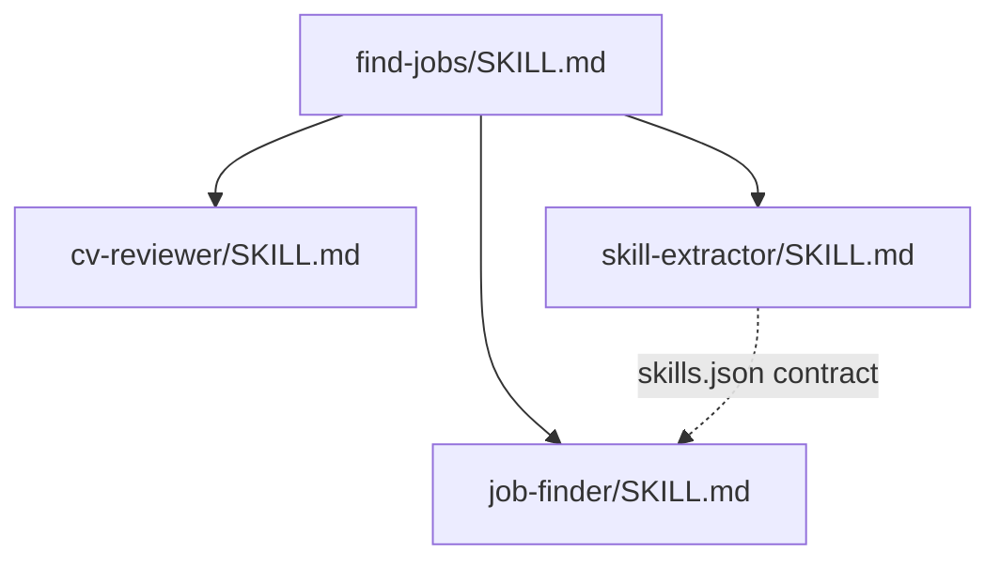

# Code Structure

## Build System
- **Type**: none. Skills are Markdown loaded by Claude Code from `.claude/skills/`.
- **Configuration**: YAML frontmatter in each `SKILL.md` (`name`, `description`,
  `argument-hint`, `context`, `agent`, `allowed-tools`).

## Key Classes/Modules

Text alternative: `find-jobs` invokes the other three skills; `skill-extractor` and
`job-finder` share the `output/skills.json` contract.

### Existing Files Inventory
- `.claude/skills/cv-reviewer/SKILL.md` - CV review instructions and `cv-review.md` template
- `.claude/skills/skill-extractor/SKILL.md` - extraction rules and `skills.json` schema
- `.claude/skills/job-finder/SKILL.md` - search, verify, score rules and `jobs.md` template
- `.claude/skills/find-jobs/SKILL.md` - pipeline orchestration
- `config/preferences.md` - global search preferences template (versioned)
- `README.md` - user documentation, includes usage and layout
- `CLAUDE.md` - project instructions, documents commands and output paths
- `.gitignore` - ignores `profiles/`, `output/`, `aidlc-workflows/`

## Design Patterns
### File hand-off pipeline
- **Location**: all skills
- **Purpose**: each step can be inspected, edited and re-run alone
- **Implementation**: fixed paths in `output/`

### Forked worker skills
- **Location**: cv-reviewer, skill-extractor, job-finder
- **Purpose**: keep the main context small; restrict tools per skill
- **Implementation**: `context: fork` frontmatter

### Defaulting input selection
- **Location**: cv-reviewer, skill-extractor
- **Purpose**: zero-argument usage
- **Implementation**: "most recently modified CV in `profiles/`"

## Critical Dependencies
### Claude Code skills runtime
- **Version**: current Claude Code
- **Usage**: loads and runs every skill
- **Purpose**: the only runtime
