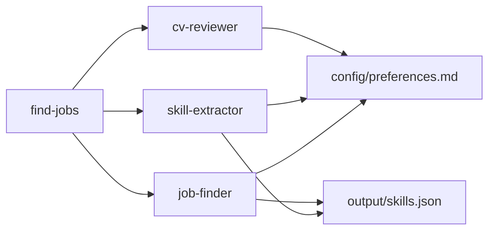

# Dependencies

## Internal Dependencies

Text alternative: find-jobs depends on the three worker skills; skill-extractor writes
and job-finder reads `output/skills.json`; all three workers read `config/preferences.md`.

### find-jobs depends on cv-reviewer, skill-extractor, job-finder
- **Type**: Runtime
- **Reason**: invokes them with the Skill tool

### job-finder depends on skill-extractor
- **Type**: Runtime (data contract)
- **Reason**: reads the `output/skills.json` that skill-extractor writes

## External Dependencies
### Claude Code
- **Version**: current
- **Purpose**: skill runtime, WebSearch, WebFetch
- **License**: Anthropic terms
